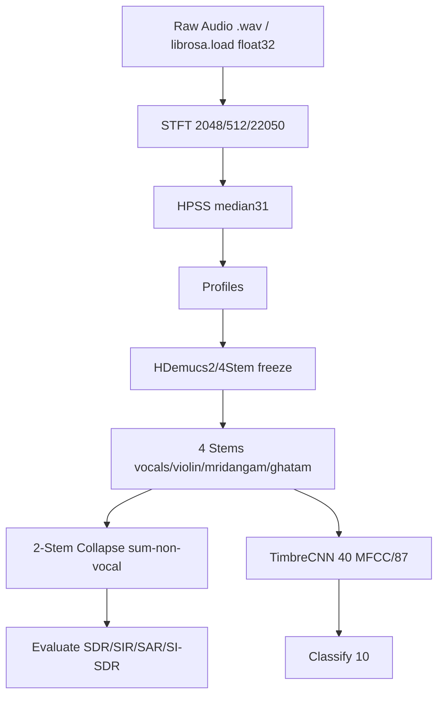

# Computational Musicology — Indian Art Music

> [!NOTE]
> Locked benchmark (~7.87 dB SDR, 2-stem Sanidha paper, fine-tuned Spleeter). 4-stem NOT directly comparable (CLAUDE.md line 28).

---

## Milestones (Verified)
| # | Status | Contract |
|---|---|---|
| 1 | Done | float32 fixtures (CLAUDE.md 47) |
| 2 | Done | HDemucs freeze; checkpoint |
| 3 | Done | np.ascontiguousarray; PCM_16 |
| 4 | Done | TimbreCNN 10 classes; 40 MFCC × 87 |

---

## Pipeline (Mermaid)


---

## Benchmark (Verified — Concert 03)
> [!WARNING] 4-stem NOT comparable to ~7.87 directly. Only 2-stem collapsed compares.

```
Sanidha ~7.87  ████████████████████████████
Our 2-stem 9.78  ██████████████████████████████████ (+1.91)
Our 4-stem 3.17  ██████████ (NOT vs 7.87)
Vocals 10.70  Violin 6.31  Mridangam 1.75  Ghatam -6.08
```

| Metric | Value | Caveat |
|---|---|---|
| Baseline | 7.87 dB | 2-stem only |
| 2-stem collapsed | 9.78 dB | +1.91 vs paper |
| 4-stem mean | 3.17 dB | Not comparable to 7.87 |

---

## Dataset (Verified — No Silent Decisions)
> [!CAUTION] Concert 3 guard (ValueError); artist-overlap audit UNVERIFIED per CLAUDE.md.

---

## Reproducibility Contracts
- float32 `astype(np.float32)` — CLAUDE.md 47; never float64 default
- PCM_16 write; `np.ascontiguousarray`; `np.zeros(..., order="C")`; primary-only RMS filter

---

*Co-Authored-By: Claude Code <noreply@anthropic.com>*  
*🤖 Generated with [Claude Code](https://claude.com/claude-code)*
