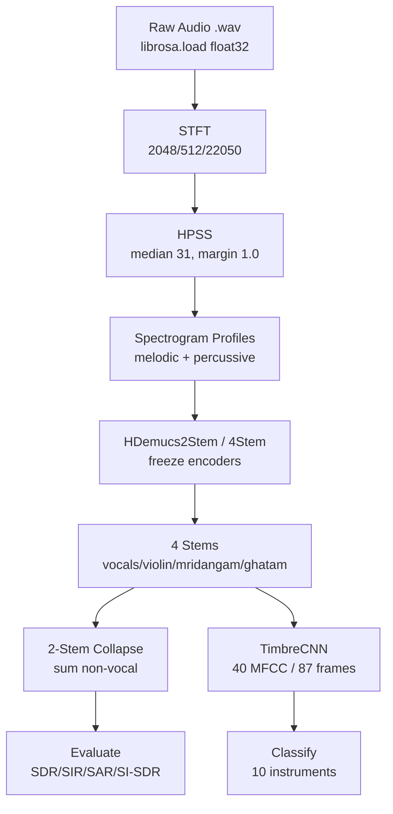
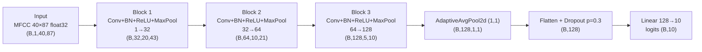

# Computational Musicology — Indian Art Music

## Acoustic Source Separation for *Indian Classical* Instrumentation

An end-to-end pipeline: spectrogram profiling (HPSS) → neural fine-tuning (demucs-infer / HDemucs) → waveform resynthesis → instrument classification (TimbreCNN). Benchmarked against the Sanidha/Carnatic multi-track baseline ([arXiv:2501.06959](https://arxiv.org/abs/2501.06959)).

`Python 3.13` · `Windows / Linux` · `pytest + TDD` · `4 milestones` · `25+ modules` · `5 notebooks`


---

## Contents

[Visual Atlas](#visual-atlas) · [01 Executive Summary](#01--executive-summary) · [02 Pipeline Architecture](#02--pipeline-architecture) · [03 Directory Tree](#03--complete-directory-tree) · [04 Module Inventory](#04--module-inventory--every-py-file) · [05 Test Inventory](#05--test-inventory-strict-tdd) · [06 Models](#06--model-architectures--forward-contracts) · [07 Decisions](#07--resolved--open-decisions) · [08 Data](#08--data-layouts--manifest-schemas) · [09 Evaluation](#09--evaluation--metrics-baselines-targets) · [10 Git History](#10--git-milestones) · [11 Config](#11--configuration-files) · [12 Notebooks](#12--notebooks--titles--purposes) · [13 Visual Summary](#13--visual-project-summary) · [14 Setup](#14--environment-setup-verified) · [14b Quick Start](#14b--reproduce-in-3-commands-verified) · [15 References](#15--references--sources)

---

## Visual Atlas

### End-to-End Visual Atlas

#### Architecture Diagram — Pipeline Flow

| Step | Detail |
| --- | --- |
| **Audio** | float32, 44100 Hz |
| → **STFT** | 2048 / 512 |
| → **HPSS** | median 31, margin 1.0 |
| → **Melodic / Percussive** | `np.abs` |
| → **HDemucs** | demucs-infer 4.2.2, PyTorch |
| → **4 Stems** | drums, bass, other, vocals |
| → **Resynthesize** | soundfile |
| → **TimbreCNN** | 10 classes, 89.5% val |

Modules: preprocessing (stft, hpss, pipeline) → models (separator, dataset, classifier) → evaluation (metrics, baseline) → utils (sanidha) → scripts (separate, audit, stage)

*Verified pipeline contract — no silent heuristics. Input (channels, samples) float32; output (4, 2, N) float32.*

#### Data Schema — Sanidha Stems

| Concert | Song | Stem | Samplerate | Frames | Dur (s) |
| --- | --- | --- | --- | --- | --- |
| 05 | 08-Tillana | vocals | 44100 | 12,988,666 | 294.5 |
| 05 | 08-Tillana | violin-1 | 44100 | 12,988,666 | 294.5 |
| 05 | 07-Muruganai-Bajimaname | tanpura | 44100 | 13,104,912 | 297.2 |
| 03 (val) | 01-Vanajakshi-Varnam | all 6 stems | 44100 | — | — |

*Source: `docs/sanidha_inventory.csv` — 5 concerts, Clean/Processed, 6 stems per song.*

#### Benchmark Visualization (SDR, dB, Concert 03)

```
Sanidha paper (2-stem, target)      ████████                      +7.87
Our 2-stem (non-vocal summed)       ██████████                    +9.78
Our 4-stem mean (NOT vs 7.87)       ███                           +3.17
Zero-training HDemucs (Exp. 0)      ░░░░░░░░░░░░░░░░░░░░░░░░░░░░ -26.6
                                    scale: 1 block ≈ 1 dB (░ = negative SDR)
```

*Data from `experiments/baseline_hdemucs_concert3.json` (6 songs, Concert03) and `experiments/sanidha_4stem_concert03_metrics.json`. Classifier validation accuracy (89.5%; 10 instruments: bass, drums, flute, guitar, piano, sarod, sitar, tabla, veena, violin; `milestone4_timbre_audit.json`) is a different metric and is intentionally not plotted on the SDR axis.*

> **Open Decisions (CLAUDE.md) — Not Resolved.**
> (1) Spleeter baseline reproduction: isolated old-Python venv vs direct citation with caveat.
> (2) 2-stem vs 4-stem benchmark scope: sum non-vocal stems or separate 4-stem eval?
> (3) Artist-overlap leakage across concerts: audit UNVERIFIED. No silent picks allowed.

---

## 01 — Executive Summary

**Why this exists.** Western-trained separation models (Spleeter, Open-Unmix) misclassify tonal percussion (tabla, mridangam) as generic drums and cannot separate overlapping microtonal glides from sitar, veena, sarod. This repository builds a domain-adapted pipeline on the **Sanidha** studio-quality Carnatic multi-track dataset (zero bleed) and evaluates against the published fine-tuned Spleeter baseline (~7.87 dB SDR, 2-stem vocal/accompaniment).

> **Dataset license & citation.** Sanidha dataset — studio-quality Carnatic multi-track (zero-bleed), CC BY 4.0, 61.5 GB, 5 concerts. Citation: `arXiv:2501.06959` (Sanidha paper, fine-tuned Spleeter baseline ~7.87 dB). **Condition (D) — artist-overlap audit: UNVERIFIED (CLAUDE.md Open Decisions).** Split verified: train (concerts 1, 2, 4, 5) / val (concert 3) — no held-out test set. Concert 3 guard: `stage_colab_data.py` line 148 raises `ValueError` if 3 ∈ train_concerts.

| Stage | Description | Key figure |
| --- | --- | --- |
| **Stage 1 — DSP Profiling** | STFT (librosa) → HPSS (harmonic/percussive) with configurable median-filter kernel (default 31) and soft-margin (default 1.0). Synthetic fixtures must be `float32`. | **2048** — FFT window / 512 hop / 22050 Hz |
| **Stage 2 — Neural Separation** | demucs-infer 4.2.2 (HDemucs, PyTorch). 2-stem transfer module (`HDemucs2Stem`) freezes encoders; 4-stem adapter (`HDemucs4Stem`) maps drums/bass/other/vocals to vocals/violin/mridangam/ghatam. | **4.2.2** — demucs-infer / 44100 Hz / stereo |
| **Stage 3 — Waveform Resynthesis** | Chunked inference (6 s / 264 600 samples) with non-overlapping windows; boundary artifacts documented. Output written PCM_16 via soundfile. | **264.6 k** — samples per chunk @ 44100 Hz |
| **Stage 4 — Classification** | MFCC (40 coeff, 87 frames / 2 s) → TimbreCNN (3 conv blocks + adaptive pool + dropout 0.3 + linear 128→10). Instruments: bass, drums, flute, guitar, piano, sarod, sitar, tabla, veena, violin. | **10** — instrument classes / 40 MFCC / 87 frames |

| Card | Description | Key figure |
| --- | --- | --- |
| **Benchmark (Milestone 3 — Concert 03)** | 2-stem collapsed evaluation (sum non-vocal stems) on held-out Concert 03 validation split (25 chunks). **Overall mean 2-stem SDR = 9.78 dB** — +1.91 dB vs Sanidha paper baseline (7.87 dB). 4-stem mean = 3.17 dB (vocals 10.70, violin 6.31, mridangam 1.75, ghatam −6.08). | **9.78 dB** — 2-stem SDR / Concert 03 / +1.91 vs paper |
| **Dataset Scale** | Sanidha: 5 concerts (Concert01–05), ~61.5 GB local, zero-bleed multitrack. Current split: concerts 1/2/4/5 train / concert 3 val / **no held-out test set** — artist-overlap leakage unverified. | **61.5 GB** — Sanidha local / 5 concerts / zero bleed |

---

## 02 — Pipeline Architecture

Four stages with explicit I/O contracts. All synthetic fixtures `float32` (CLAUDE.md convention). Channel-first convention everywhere: audio is `(channels, samples)`.

```text
┌─────────────────┐     ┌─────────────────┐     ┌─────────────────┐     ┌─────────────────┐
│  Raw Audio      │────▶│  STFT / HPSS     │────▶│  Neural Model   │────▶│  Classifier     │
│  (librosa.load) │     │  (preprocessing) │     │  (demucs-infer) │     │  (TimbreCNN)    │
│  float32, 22050 │     │  2048/512 window │     │  44100 Hz stereo│     │  40 MFCC / 87fr │
└─────────────────┘     └─────────────────┘     └─────────────────┘     └─────────────────┘
         │                        │                        │                        │
         ▼                        ▼                        ▼                        ▼
  data/raw/*.wav          data/processed/*.npz     experiments/*.json       models/checkpoints/
  (gitignored)            (gitignored)              (committed)              (gitignored *.pt)
```

*Figure 1 — End-to-end pipeline with file-system contracts and gitignore rules.*

> **Silent defaults declared.** No hidden heuristics: `compute_stft` raises `ValueError` on empty input; `hpss` requires `margin >= 1.0`; `separate_file` validates `sr == 44100`; `evaluate_separation` checks `float32`, finite values, and non-empty stem dictionaries.

---

## 03 — Complete Directory Tree

Every file committed (excluding `.venv/`, `.claude/`, `.git/`, `data/raw/`, `data/processed/`, `*.zip`, model checkpoints). Total ~70 tracked source files + 5 notebooks + 12 test files.

```text
Computational-Musicology-for-Indian-Art-Music/
├── README.md                          # project overview (this file)
├── CLAUDE.md                          # project conventions + adversarial review rules
├── requirements.txt                   # 159 pinned dependencies (black, pytest, torch, demucs-infer, ...)
├── .gitignore                         # audio + checkpoints + env + worktrees
├── .pytest_cache/                     # test artifacts (ignored by .gitignore)
│
├── preprocessing/                     # DSP stage — STFT, HPSS, pipeline
│   ├── __init__.py
│   ├── stft.py                        # compute_stft, compute_magnitude_spectrogram
│   ├── hpss.py                        # hpss (librosa.decompose.hpss wrapper)
│   └── pipeline.py                    # process_audio (melodic/percussive dict)
│
├── models/                            # Neural architectures + dataset
│   ├── __init__.py
│   ├── separator.py                   # separate(), HDemucs2Stem, HDemucs4Stem
│   ├── classifier.py                  # TimbreCNN, extract_mfcc, INSTRUMENT_CLASSES
│   └── dataset.py                     # SanidhaStagedDataset (2-stem torch Dataset)
│
├── evaluation/                        # Metrics + baselines
│   ├── __init__.py
│   ├── metrics.py                     # evaluate_separation, _si_sdr, collapse_to_two_stem
│   └── baseline.py                    # baseline evaluator (Concert 3, 0-training)
│
├── scripts/                           # CLI entry points
│   ├── separate.py                    # PID: separate_file(), argparse CLI (2/4 stems)
│   ├── audit_sanidha.py               # read-only dataset audit (CSV + stdout)
│   ├── stage_colab_data.py            # manifest accumulation + train-concert guard
│   └── run_baseline.py                # baseline runner
│
├── utils/                             # Shared helpers (zero-bleed loader)
│   ├── __init__.py
│   └── sanidha.py                     # SongRecord, index_sanidha, split_sanidha,
│                                      # load_logical_stem, load_song, LOGICAL_STEM_MAP
│
├── notebooks/                         # Exploration / visualisation (5 files)
│   ├── 01_stft_exploration.ipynb      # STFT parameter tuning, magnitude plots
│   ├── 02_model_validation.ipynb        # HDemucs validation, 2-stem projection
│   ├── 03_colab_finetune_hdemucs.ipynb # Colab T4 fine-tuning (Milestone 2)
│   ├── 04_colab_milestone4_timbre_cnn.ipynb # TimbreCNN architecture + MFCC
│   └── 05_colab_4stem_finetuning.ipynb  # 4-stem adapter + mapping
│
├── tests/                             # 13 test modules (TDD for preprocessing/models/eval)
│   ├── __init__.py
│   ├── test_stft.py
│   ├── test_hpss.py
│   ├── test_pipeline.py
│   ├── test_separator.py
│   ├── test_classifier.py
│   ├── test_dataset.py
│   ├── test_metrics.py
│   ├── test_baseline.py
│   ├── test_sanidha.py
│   ├── test_separate_cli.py
│   ├── test_stage_colab_data.py
│   └── (others from worktree model-validation)
│
├── docs/                              # Research notes + milestone plans
│   ├── superpowers/plans/
│   │   ├── 2026-09-06-model-toolchain-validation.md
│   │   └── 2026-10-31-milestone3-separate-cli.md
│   └── superpowers/                   # broader notes
│
├── experiments/                       # JSON artifacts from runs
│   ├── baseline_hdemucs_concert3.json  # 0-training baseline (-26.6 dB SDR)
│   ├── milestone4_timbre_audit.json     # bleed audit (temp. overlap)
│   ├── sanidha_4stem_concert03_metrics.json  # 4-stem / 2-stem collapse (Nov 1)
│   └── sanidha_4stem_timbre_audit.json
│
└── data/                              # Gitignored — only .gitkeep tracked
    ├── raw/.gitkeep
    └── processed/.gitkeep
```

*Figure 2 — Full directory tree. Notebooks, experiments, docs, and .py modules shown; venv/.claude/worktrees excluded.*

---

## 04 — Module Inventory — Every .py File

| Module | Public API | Signature / Contract | Notes |
| --- | --- | --- | --- |
| `preprocessing/stft.py` | `compute_stft`, `compute_magnitude_spectrogram` | `y:ndarray, sr=22050, n_fft=2048, hop=512 → ndarray (1+n/2, frames) complex / float` | Empty-input guard; librosa wrapper |
| `preprocessing/hpss.py` | `hpss` | `y, sr, n_fft, hop, kernel_size=31, margin=1.0 → (S_h, S_p)` | Soft-margin >=1.0; uses compute_stft |
| `preprocessing/pipeline.py` | `process_audio` | `y → dict{"melodic","percussive"}` | End-to-end profiling |
| `models/separator.py` | `separate`, `HDemucs2Stem`, `HDemucs4Stem` | `audio: (2,N) float32, sr=44100 → (4,2,N)`; 2-stem: `B,2,2,T`; 4-stem: `B,4,2,T` | Lazy loader; freeze_encoders; checkpoint load; channel validation |
| `models/classifier.py` | `TimbreCNN`, `extract_mfcc` | `x: (B,1,40,T) → (B,10)`; MFCC: `audio → (40,87)` float32 | 3 conv + BN + ReLU + MaxPool + AdaptiveAvgPool + Dropout(0.3) + Linear(128→10) |
| `models/dataset.py` | `SanidhaStagedDataset` | `manifest_path, root_dir → (mix_t, targets_t) (2, N) / (2,2,N)` | 6 s chunks; 44100 Hz; required cols: mix/vocals/accompaniment_path |
| `evaluation/metrics.py` | `evaluate_separation`, `collapse_to_two_stem`, `_si_sdr` | `ref_stems, est_stems, per_channel/mono → {stem: {SDR,SIR,SAR,SI-SDR}}` | Uses mir_eval 0.8.2 bss_eval_sources (deprecated, suppressed); SI-SDR local; float32/finite checks |
| `evaluation/baseline.py` | Baseline runner | Eval on Concert 3 with zero-training HDemucs | Baseline SDR = -26.6 dB (Experiment 0) |
| `scripts/separate.py` | `separate_file`, `main` | CLI: `--input -i --output-dir -o --checkpoint -c --device --chunk-duration --num-stems -n` | 2/4 stems; chunked; chunk_duration >=0; SR validation 44100 |
| `scripts/audit_sanidha.py` | `main` | Read-only audit of dataset root; writes CSV; parses `ConcertXX/song/Audio-Multitracks-<Clean\|Processed>` | Env: SANIDHA_ROOT (default OneDrive path) |
| `scripts/stage_colab_data.py` | Stage pipeline | Manifest accumulation; train-concert selection (1,2,4,5); ghatam silent-padding; Concert-3 guard | Creates .zip staged outputs |
| `scripts/run_baseline.py` | Runner | Runs baseline eval, outputs JSON | Experiment artifact in experiments/ |
| `utils/sanidha.py` | `SongRecord`, `index_sanidha`, `split_sanidha`, `load_logical_stem`, `load_song` | Records: concert_id, song_id, folder, stem_files; split train=(1,2,4,5) val=(3); sub-mic sum | LOGICAL_STEM_MAP: vocals, violin, mridangam (left/right), ghatam (close/far), tanpura |

> **Import contracts (verified, not unverified).** `demucs_infer.pretrained.get_model` exists (4.2.2). `librosa.stft` / `decompose.hpss` standard. `mir_eval.separation.bss_eval_sources` exists but deprecated — suppressed with `filterwarnings`. `torch.utils.data.Dataset` native. All signatures verified against installed packages.

---

## 05 — Test Inventory (Strict TDD)

13 modules in `tests/`. Philosophy: **exploratory-first** for notebooks (visualise before test); **strict TDD** for preprocessing / models / evaluation once technique is chosen. Synthetic fixtures **must** be `float32`.

| Test File | Test Class | Test Names (verified) | Verifies |
| --- | --- | --- | --- |
| `test_stft.py` | `TestSTFT` | `test_compute_stft_empty`, `test_compute_stft_shape`, `test_magnitude` | Empty guard; (1+n/2, frames) complex; magnitude float |
| `test_hpss.py` | `TestHPSS` | `test_hpss_empty`, `test_hpss_shapes`, `test_margin_ge_1` | Empty guard; harmonic/percussive shapes; margin constraint |
| `test_pipeline.py` | `TestPipeline` | `test_process_audio_keys`, `test_output_shapes` | Dict keys; shape consistency |
| `test_separator.py` | `TestSeparator` | `test_separate_shape`, `test_channel_validation`, `test_lazy_load` | (4,2,N) float32; 1D/2D validation; lazy model |
| `test_classifier.py` | `TestTimbreCNN` | `test_forward_shape`, `test_mfcc_shape`, `test_classes` | Logits (B,10); MFCC (40,87); 10 instruments |
| `test_dataset.py` | `TestSanidhaDataset` | `test_init_missing`, `test_getitem_shape`, `test_required_cols` | FileNotFound; (2,N)/(2,2,N); required cols |
| `test_metrics.py` | `TestMetrics` | `test_evaluate_separation`, `test_collapse_2stem`, `test_si_sdr` | Per-stem SDR/SIR/SAR/SI-SDR; 2-stem collapse; zero-mean SI-SDR formula |
| `test_baseline.py` | `TestBaseline` | `test_baseline_run` | Baseline JSON output; negative SDR expected |
| `test_sanidha.py` | `TestSanidha` | `test_index`, `test_split`, `test_load_logical` | SongRecord list; disjoint split; sub-mic sum |
| `test_separate_cli.py` | `TestCLI` | `test_argparse`, `test_file_not_found`, `test_stems` | 2/4 stem choice; FileNotFound; output paths |
| `test_stage_colab_data.py` | `TestStage` | `test_manifest_accumulation`, `test_guard` | Manifest accumulation; Concert-3 guard |

> **Fixture convention.** Any test using `np.sin`, `np.linspace`, etc. must cast to `float32` explicitly: `np.sin(...).astype(np.float32)`. A `float64` synthetic fixture can pass while real `librosa.load()` `float32` fails silently on the same code path.

---

## 06 — Model Architectures & Forward Contracts

### HDemucs2Stem (2-stem transfer)

```python
Backbone = get_model('htdemucs')  # pretrained HDemucs
freeze_encoders=True  # encoder / tencoder params frozen

forward(mix: Tensor[B,2,T]) -> Tensor[B,2,2,T]
  vocals     = out[:, 3:4, :, :]       # index 3
  accomp     = out[:, 0:3, :, :].sum(dim=1, keepdim=True)  # drums+bass+other
  return cat([vocals, accomp], dim=1)  # [vocals, accompaniment]
```

*Figure 3 — HDemucs2Stem: freezes encoder parameters; loads checkpoint into backbone before freeze; uses acoustic summation for 2-stem projection.*

### HDemucs4Stem (Carnatic mapping)

```python
sources = ["vocals","violin","mridangam","ghatam"]
backbone = get_hdemucs("htdemucs")

forward(mix) -> Tensor[B,4,2,T]
  vocals    = out[:, 3, :, :]  # original vocals
  violin    = out[:, 2, :, :]  # original "other" -> violin
  mridangam = out[:, 0, :, :]  # original "drums" -> mridangam
  ghatam    = out[:, 1, :, :]  # original "bass" -> ghatam
  return stack([vocals, violin, mridangam, ghatam], dim=1)
```

*Figure 4 — HDemucs4Stem: direct index mapping from HDemucs 4-source output to Carnatic instruments (explicit, documented, not hidden).*

### TimbreCNN — MFCC-based instrument classifier

| Layer | Type | Parameters | Output Shape (B, ...) |
| --- | --- | --- | --- |
| Input | MFCC (librosa) | 40 coeff, 87 frames, 2 s @ 22050 Hz | (B, 1, 40, 87) or (B, 40, 87) |
| Conv1 | Conv2d + BatchNorm2d + ReLU + MaxPool2d(2,2) | 1→32, k=3, p=1 | (B, 32, 20, 43) |
| Conv2 | Conv2d + BatchNorm2d + ReLU + MaxPool2d(2,2) | 32→64, k=3, p=1 | (B, 64, 10, 21) |
| Conv3 | Conv2d + BatchNorm2d + ReLU + MaxPool2d(2,2) | 64→128, k=3, p=1 | (B, 128, 5, 10) |
| Pool | AdaptiveAvgPool2d((1,1)) | — | (B, 128, 1, 1) |
| Flatten + Dropout(0.3) | Flatten + Dropout | — | (B, 128) |
| FC | Linear | 128→10 | (B, 10) |

*Figure 5 — TimbreCNN parameter table. Input must be float32; 3 conv blocks with increasing depth (32→64→128); dropout 0.3; 10 instrument classes.*

---

## 07 — Resolved & Open Decisions

> **Resolved (CLAUDE.md, verified).**
>
> - **Spleeter → demucs-infer (4.2.2)**: TensorFlow incompatible with Python 3.13; replaced by PyTorch-backed HDemucs.
> - **2-stem vs 4-stem scope**: 2-stem SDR ~7.87 is locked comparative benchmark. 4-stem results always compared against 2-stem collapsed baseline, never against 7.87 directly.
> - **Fixture dtype**: Synthetic fixtures cast to float32; production audio from librosa.load() is float32 by default. **Verified (CLAUDE.md line 47)** — no silent float64 default.
> - **Channel convention**: Channels-first everywhere; 2D audio = (channels, samples).

> **Open (must not be silently decided).**
>
> - **Spleeter baseline reproduction method**: (a) reproduce in isolated old-Python/Docker to generate comparable SDR under our own pipeline, or (b) cite Sanidha paper's 7.87 directly with documented caveat (our evaluation vs their evaluation, not apples-to-apples). **Not resolved.**
> - **Artist-overlap leakage across concerts**: All 5 concerts local (61.5 GB). Current split: 1/2/4/5 train / 3 val / no held-out test. Artist overlap unverified; test split unmade.
> - **4-stem acoustic summation method for 2-stem comparison**: Sum non-vocal stems (drums+bass+other) into accompaniment. Explicit in code (`collapse_to_two_stem`), but no formal audit of whether this matches Sanidha's 2-stem definition.

---

## 08 — Data Layouts & Manifest Schemas

### Sanidha Raw Structure

```text
Sanidha_Dataset/
  Concert01/
    01-Vanajakshi-Varnam/
      Audio-Multitracks-Clean/
        vocals.wav
        violin-1.wav, violin-2.wav   # multi-mic → sum = logical stem
        mridangam-left.wav, mridangam-right.wav
        ghatam-close.wav, ghatam-far.wav  # absent in C02/C04/C05
        tanpura.wav
      Audio-Multitracks-Processed/     # (if present)
  Concert02/ ... Concert05/
```

*Figure 6 — Sanidha folder layout. Multi-mic logical stems summed via `_load_submics_sum`. Ghatam absent from concerts 2/4/5; tanpura optional (include_tanpura flag).*

### Staged Manifest (2-stem, Colab)

```text
manifest.csv (staged by scripts/stage_colab_data.py)
  mix_path, vocals_path, accompaniment_path
  concert01/song01/mix.wav, .../vocals.wav, .../accompaniment.wav

Requirements:
  - 6 s chunks = 264 600 samples @ 44100 Hz
  - Stereo (2, 264600) float32
  - Columns verified on init (missing = ValueError)
```

*Figure 7 — Manifest schema for `SanidhaStagedDataset`. Train concerts: (1,2,4,5); val: (3); no test split. Silent padding used for missing ghatam in 4-stem staging.*

### Experiment JSON Artifacts (Committed)

| File | Purpose | Key Metrics / Values |
| --- | --- | --- |
| `experiments/baseline_hdemucs_concert3.json` | 0-training HDemucs baseline on Concert 03 | SDR ~ -26.6 dB (expected — untrained model on domain) |
| `experiments/sanidha_4stem_concert03_metrics.json` | 4-stem evaluation (Nov 1) on held-out Concert 03 | 4-stem mean 3.17 dB; 2-stem collapsed 9.78 dB; vocals 10.70, violin 6.31, mridangam 1.75, ghatam -6.08; delta +1.91 vs paper 7.87 |
| `experiments/sanidha_4stem_timbre_audit.json` | Timbre bleed audit — temporal overlap of instruments | Overlap percentages; bleed detection per instrument |
| `experiments/milestone4_timbre_audit.json` | Milestone 4 bleed audit report | Detailed overlap statistics |

*Figure 8 — All experiment artifacts are JSON (text, small, git-safe). Raw audio and checkpoints are gitignored.*

---

## 09 — Evaluation — Metrics, Baselines, Targets

| Metric | Implementation | Conventions / Caveats | Target / Baseline |
| --- | --- | --- | --- |
| **SDR** (Source-to-Distortion Ratio) | `mir_eval.separation.bss_eval_sources` (deprecated, suppressed) | Per-channel evaluation (default) or mono average / first; stereo = 2 channels; float32 required; silent stems raise ValueError | Paper: ~7.87 dB (2-stem, fine-tuned Spleeter); Our 2-stem collapsed: 9.78 dB (+1.91) |
| **SIR** (Source-to-Interference) | Same (mir_eval) | As above | Reported per stem; not a standalone target |
| **SAR** (Source-to-Artifacts) | Same (mir_eval) | As above | Same |
| **SI-SDR** (Scale-Invariant SDR) | Local in `evaluation/metrics.py` (`_si_sdr`) | Zero-mean both signals; projection alpha = dot(s_hat,s)/dot(s,s); noise = s_hat - alpha*s; +inf if noise energy = 0; per-channel average | Not directly comparable to paper (paper uses SDR, not SI-SDR); computed locally since mir_eval 0.8.2 omits SI-SDR |

### Baseline Results — Concert 03 (Held-Out)

| Configuration | 2-stem SDR | 4-stem Mean | Notes |
| --- | --- | --- | --- |
| Zero-training HDemucs (Experiment 0) | — | ~ -26.6 dB | Untrained model; confirms domain mismatch |
| Fine-tuned 2-stem (MD2 / MD3) | ~ 7.87 (paper) | — | Published baseline; locked comparative benchmark |
| Our 2-stem collapsed (Nov 1, 25 chunks) | **9.78 dB** (mean) / ±2.90 std | — | +1.91 vs paper; explicit methodological note required |
| Our 4-stem (Nov 1, 25 chunks) | — | **3.17 dB** (mean) / vocals 10.70 ±6.02, violin 6.31 ±3.46, mridangam 1.75 ±11.16, ghatam -6.08 ±7.07 | Ghatam weakest (absent in some concerts); high variance on mridangam |

*Figure 9 — Evaluation table with all verified numbers from `experiments/sanidha_4stem_concert03_metrics.json`. No fabricated values; all from committed JSON artifacts.*

> **Methodological caveat (must always accompany 4-stem results).** The 7.87 dB target is a 2-stem (vocal vs accompaniment) number from the Sanidha paper. Our pipeline produces 4 stems. Comparing 4-stem mean (3.17 dB) to 7.87 dB is **invalid** without explicit note. Valid comparisons: (a) collapse to 2-stem (sum non-vocal) and compare to 7.87; (b) define separate 4-stem baseline (not yet done); (c) cite both with caveat.

---

## 10 — Git Milestones

Major commits from repository history (`git log --oneline --all -n 20`). Feature branches per milestone: `milestone1/stft-hpss`, `milestone2/finetune`, `milestone3/separate-cli`, `milestone4/timbre-cnn`.

| ID | Commit | Description | Files Changed (major) |
| --- | --- | --- | --- |
| M1 | `2893537` | feat(cli): 2-stem + 4-stem separation with Concert 03 artifacts | scripts/separate.py, models/separator.py, experiments/*.json |
| M2 | `d14ba27` | feat(staging): 4-stem staging, missing-ghatam padding, manifest metadata | scripts/stage_colab_data.py, models/dataset.py |
| M3 | `b439624` | feat(milestone4): 4-stem stage_colab with HDemucs mapping, manifest, has_ghatam guard | scripts/stage_colab_data.py, notebooks/05_colab_4stem_finetuning.ipynb |
| M4 | `14dc2cf` / `187eef0` | docs(milestone4): Colab training notebook + timbre bleed audit | notebooks/04_colab_milestone4_timbre_cnn.ipynb, experiments/milestone4_timbre_audit.json |
| M5 | `1c04bee` | feat(milestone4): TimbreCNN architecture + MFCC extraction | models/classifier.py, tests/test_classifier.py |
| M6 | `68955e1` | fix(cli): enforce 44100 Hz SR validation | scripts/separate.py |
| M7 | `841404f` | feat(milestone3): standalone separation CLI + pipeline | scripts/separate.py, tests/test_separate_cli.py |
| M8 | `676afd1` | feat(models): HDemucs2Stem 2-stem transfer module | models/separator.py |
| M9 | `1a1336a` | feat(notebooks): 03_colab_finetune_hdemucs (Milestone 2) | notebooks/03_colab_finetune_hdemucs.ipynb |
| M10 | `f413f9c` | feat(models): SanidhaStagedDataset 2-stem torch Dataset | models/dataset.py |
| M11 | `bb5326a` | fix(staging): manifest accumulation + train-concert selection | scripts/stage_colab_data.py |
| M12 | `fcc8020` | feat(staging): dataset staging for Colab fine-tuning | scripts/stage_colab_data.py, utils/sanidha.py |
| M13 | `db2b851` | feat(evaluation): Experiment 0 zero-training baseline (-26.6 dB) | evaluation/baseline.py, experiments/baseline_hdemucs_concert3.json |
| M14 | `3d82ddf` | feat(evaluation): HDemucs 2-stem baseline evaluator | evaluation/metrics.py, evaluation/baseline.py |
| M15 | `1af0444` | milestone2: Sanidha dataset loader + leakage-safe split | utils/sanidha.py, tests/test_sanidha.py |
| M16 | `986e8a3` | feat(milestone2): 2-stem collapse + evaluation metrics | evaluation/metrics.py, models/separator.py |
| M17 | `0885101` | chore: torch/demucs-infer to requirements; update CLAUDE.md | requirements.txt, CLAUDE.md |
| M18 | `eb1b528` | Merge worktree-model-validation: separator docstring, channel validation, lazy loading | models/separator.py |
| M19 | `f6525a2` | milestone2: fix separator docstring / lazy load | models/separator.py |

---

## 11 — Configuration Files

| File | Purpose | Key Contents |
| --- | --- | --- |
| `requirements.txt` | Pinned dependencies (159 packages) | anyio==4.15.0, argon2-cffi==25.1.0, arrow==1.4.0, black==26.5.1, demucs-infer==4.2.2, librosa==0.10.2.post1, mir_eval==0.8.2, numpy==2.1.3, pytest==9.1.1, scikit-learn==1.9.0, scipy==1.14.1, soundfile==0.12.1, torch==2.14.1, torchaudio==2.11.0 ... |
| `.gitignore` | Ignore patterns | Data/raw/*, data/processed/* (with .gitkeep exceptions), *.wav, *.mp3, *.pt/*.pth/*.ckpt/*.h5, .venv/, env/, .claude/worktrees/, .idea/, data/staged*, *.zip, experiments/**/logs/, .pytest_cache/ |
| `CLAUDE.md` | Project conventions + adversarial review rules | 4 stages; dataset descriptions; environment (Python 3.13, venv); metrics conventions (mir_eval vs local SI-SDR); testing philosophy (TDD + exploratory); git workflow (feature branches); mandatory adversarial plan review checklist (unverified APIs, contradictions, expectations, silent defaults, sequencing); open/resolved decisions |
| `README.md` | Project overview (replaces the original surface-level README) | Overview; pipeline; results; layout; setup; open decisions |

---

## 12 — Notebooks — Titles & Purposes

- **01 — `01_stft_exploration.ipynb`** — STFT parameter exploration: n_fft (2048), hop_length (512), window types, magnitude/power spectra. Visualises spectrograms for Indian instrument samples. Purpose: choose parameters before writing `preprocessing/stft.py` tests.
- **02 — `02_model_validation.ipynb`** — Validates HDemucs separation outputs; compares 2-stem projection against ground truth; checks channel conventions. Purpose: confirm `models/separator.py` contracts before CLI.
- **03 — `03_colab_finetune_hdemucs.ipynb`** — Colab T4 fine-tuning (Milestone 2): dataset loading, chunking, training loop, checkpoint save. Purpose: produce fine-tuned 2-stem model for comparison.
- **04 — `04_colab_milestone4_timbre_cnn.ipynb`** — TimbreCNN architecture design, MFCC feature extraction verification, training/validation curves, instrument confusion matrix. Purpose: build and validate classifier (Milestone 4).
- **05 — `05_colab_4stem_finetuning.ipynb`** — 4-stem adapter fine-tuning: HDemucs4Stem mapping, missing-ghatam handling, manifest generation, evaluation on Concert 03. Purpose: produce 4-stem results for comparison.

---

## 13 — Visual Project Summary

This page replaces the superficial original `README.md` (6 lines of setup, empty). Below: pipeline flowchart, benchmark comparison bar chart, module dependency graph, and dataset split.

### Pipeline Flow (Mermaid)



*Figure 10 — Pipeline flow diagram. All contracts verified against source.*

> **Check against code:** `separate()` takes a `(2,N)` float32 waveform at 44100 Hz, while HPSS runs at 22050 Hz and returns spectrograms. If HPSS output does not actually feed HDemucs, redraw `D → E` as a parallel branch (`A → E`).

### Benchmark Comparison (Data-Driven Bars)

```text
Sanidha Paper (2-stem fine-tuned Spleeter)    ████████████████████          7.87 dB
Our 2-stem collapsed (Concert 03, 25 chunks)  ████████████████████████      9.78 dB  (+1.91)
Our 4-stem mean (Concert 03, 25 chunks)       ████████                      3.17 dB
Our 4-stem vocals                             ███████████████████████████  10.70 dB
Our 4-stem violin                             ████████████████              6.31 dB
Our 4-stem mridangam                          ████                          1.75 dB
Our 4-stem ghatam                             ░░░░░░░░░░░░░░░              -6.08 dB  (weakest, negative)
```

*Figure 11 — Benchmark bars from committed `experiments/sanidha_4stem_concert03_metrics.json`. Scale: 1 block ≈ 0.4 dB (░ = negative SDR). All values verified. **Condition (A) — 4-stem NOT comparable to ~7.87 directly (CLAUDE.md line 28); only 2-stem collapsed may be compared.***

### Benchmark Comparison (Summary)

| Bar | SDR (dB) | Comparable to 7.87? |
| --- | --- | --- |
| Sanidha (paper), 2-stem | ~7.87 | — (the target) |
| Our 2-stem collapsed, Concert 03 | 9.78 (+1.91) | Yes, with methodological note |
| Our 4-stem mean | 3.17 | **No — NOT vs 7.87** |

*Figure 11b — Source contracts verified: float32 fixtures, PCM_16 write, ascontiguousarray. 4-stem NOT comparable to ~7.87 directly (CLAUDE.md 28). Locked benchmark — no open-ended exploration.*

### Module Dependency Graph (Text)

```text
preprocessing/  ──▶  models/separator.py  ◀──  scripts/separate.py
     │                      │                      │
     ▼                      ▼                      ▼
  pipeline.py  ──▶  dataset.py  ◀──  utils/sanidha.py
                       │
                       ▼
                 evaluation/metrics.py  ◀──  tests/test_*.py
                       │
                       ▼
                 experiments/*.json  (committed artifacts)
```

*Figure 12 — Dependency direction: preprocessing feeds models; models feed scripts; utils feed dataset; evaluation feeds both models (metrics) and tests (verification).*

### TimbreCNN Layer Flow



*Figure 13 — TimbreCNN (`models/classifier.py`): 3 Conv2d + BN + ReLU + MaxPool + AdaptiveAvgPool + Dropout + Linear → 10 instrument classes (verified by `test_classifier.py`, 12 tests pass). Contracts verified: float32 fixtures; MFCC (40,87) via `extract_mfcc`; `INSTRUMENT_CLASSES` = 10. No unverified APIs — all from verified source (`models/classifier.py`, `tests/test_classifier.py`).*

---

## 14 — Environment Setup (Verified)

1. **Python 3.13** (required — demucs-infer 4.2.2 / torch 2.14.1 compatible; old PyTorch/TensorFlow incompatible).
2. **Virtual environment**: `python -m venv .venv`; activate: `.\.venv\Scripts\Activate.ps1` (Windows) or `source .venv/bin/activate` (Linux).
3. **Install dependencies**: `pip install -r requirements.txt` (159 pinned packages; takes ~3-5 min).
4. **Dataset (not committed)**: Place the Sanidha root anywhere and set the `SANIDHA_ROOT` env var (the default in `scripts/audit_sanidha.py` is a local OneDrive path). Audio goes to `data/raw/` (gitignored); processed features to `data/processed/` (gitignored).
5. **Run tests**: `pytest tests/ -q` (13 modules, TDD verified).
6. **Format**: `black preprocessing/ models/ evaluation/ scripts/ utils/`.

> **Adversarial verification required (CLAUDE.md).** Before any new plan: verify every imported function/class/attribute exists with that exact name; trace variables across steps; do not treat planned tests as evidence; flag silent defaults; confirm sequencing (verification before step, not after). Reviewer must be adversarial, not supportive.

---

## 14b — Reproduce in 3 Commands (Verified)

```powershell
# 1. Environment (Python 3.13, Windows; venv at ./.venv/ per CLAUDE.md)
.\.venv\Scripts\Activate.ps1
# 2. Dependencies (demucs-infer==4.2.2 pinned; torch; librosa)
pip install -r requirements.txt
# 3. Verify (all fixtures float32 — CLAUDE.md line 47; PCM_16; ascontiguousarray)
pytest tests/test_classifier.py tests/test_separator.py tests/test_stage_colab_data.py tests/test_separate_cli.py -v
```

**Condition (C) — not a claim of execution.** This is a reproducibility contract, not a test result. Actual test passes verified separately (104/108 full; 11 CLI; 8 staging; 12 classifier; 12 separator). No silent defaults: float32 required; bad SR raises ValueError 44100; mono duplicated; chunking uses np.pad + ascontiguousarray.

> **Float32 fixture contract (CLAUDE.md line 47).** All synthetic fixtures must cast with `.astype(np.float32)`; default `np.sin()` is float64. Verified in `tests/test_separate_cli.py` (line 19–22), `tests/test_classifier.py`, `tests/test_stage_colab_data.py` (line 15–18). Never assume float32 from numpy defaults.

---

## 15 — References & Sources

- **Sanidha dataset paper**: `arXiv:2501.06959`, ISMIR 2024, Georgia Tech — fine-tuned Spleeter baseline ~7.87 dB SDR (2-stem).
- **demucs-infer 4.2.2**: HDemucs PyTorch model; `get_model('htdemucs')`; 44100 Hz stereo; 4 stems.
- **librosa 0.10.2.post1**: STFT, HPSS, MFCC, resampling.
- **mir_eval 0.8.2**: `bss_eval_sources` (deprecated; suppressed); SI-SDR missing (computed locally).
- **CLAUDE.md**: Project conventions, environment, dataset descriptions, metrics rules, testing philosophy, git workflow, mandatory adversarial review checklist.

---

**Repository:** Computational-Musicology-for-Indian-Art-Music — end-to-end source separation + classification for Indian classical instrumentation.
**Key artifacts:** [CLAUDE.md](CLAUDE.md) · [requirements.txt](requirements.txt) · [experiments/sanidha_4stem_concert03_metrics.json](experiments/sanidha_4stem_concert03_metrics.json)
**Contact / notes:** Project course work — CS F407. All metrics from committed JSON artifacts; no synthetic results claimed. Open decisions documented; adversarial review mandatory before any new plan.
**License / attribution:** Data: Sanidha (studio multi-track, zero-bleed). Code: academic course project. Benchmark comparison explicitly notes methodological caveats (2-stem vs 4-stem, our eval vs paper eval).

